# AI Video Production Playbook (Direct → Generate → Post → Deliver)

[中文版 README](README.md)

This playbook is distilled from two finished videos: a 3-minute product demo (24 shots, three characters) and a 2.5-minute algorithm explainer for UVa 10327 (presenter + code animation + flowchart).
Its goal: **any AI agent that can run shell commands and drive a browser — or a person following along — can produce a video of the same quality without depending on a particular model.**

Every decision is written down as a rule, template, numeric threshold or checklist. When something is not covered, judge it against the **Quality bar** below and record the decision in the project log.

> The detailed chapters (`01`–`05`) and templates are in Traditional Chinese, and so is the video content (Taiwan Mandarin narration). This English file summarizes all of them so a non-Chinese-reading agent can follow the whole pipeline. File and folder names are kept in Chinese because the tools and examples refer to them; the table below gives their meaning.

| Path | Meaning |
| --- | --- |
| `01_導演.md` | 01 Directing: script, storyboard, characters, dialogue, continuity |
| `02_生成_Flow.md` | 02 Generation with Google Flow: prompts, voices, credits, failure handling |
| `03_後製.md` | 03 Post-production: code animation, narration timing, voice replacement, screen compositing, subtitles |
| `04_輸出與驗收.md` | 04 Output and acceptance: assembly, encoding, automatic QA, listening checklist, delivery |
| `05_純動畫路線.md` | 05 Animation-only route (no Flow): TTS or self-recorded narration, title cards instead of on-camera presenter |
| `工具/` | Tools: `make_anim.py`, `assemble.py`, `qa.py`, `tts.py`, `storyboard.py`; `工具/合成/` screen compositing |
| `範本/` | Templates: script (`腳本範本.md`), storyboard (`分鏡表範本.md`), `project_範本.json`, `anim_template.html` |
| `範例/UVa10327/` | Full example with Flow presenter shots (assets included, rebuilds the finished video) |
| `範例/純動畫_UVa10327/` | Same topic, animation-only (no Flow, TTS narration) |
| `docs/總流程.*` | Overall pipeline diagram (SVG, interactive HTML, Archify source JSON) |
| `腳本.md` / `分鏡表.pdf` / `語音/` / `影片/` / `動畫/` / `成品/` | script / storyboard / narration audio / video clips / animation / final output |

## Quick start

```powershell
powershell -ExecutionPolicy Bypass -File setup.ps1     # Windows; macOS/Linux: bash setup.sh
.\.venv\Scripts\Activate.ps1
python 工具/make_anim.py  範例/UVa10327/project.json   # ~3 min: render the 3 explainer animations
python 工具/assemble.py   範例/UVa10327/project.json   # assemble + loudness + burned-in subtitles
python 工具/qa.py         範例/UVa10327/project.json   # automatic acceptance checks
python 工具/storyboard.py 範例/UVa10327/project.json   # storyboard PDF + Markdown
```

Output: `範例/UVa10327/成品/UVa10327講解_字幕.mp4` (about 2:25). For the animation-only example use `範例/純動畫_UVa10327/project.json`. `check_env.py` re-checks the environment at any time.

Requirements: Python 3.10+ (`requirements.txt`: numpy, imageio-ffmpeg — ships its own ffmpeg —, playwright, opencv-python, edge-tts), a Chromium/Chrome/Edge browser for frame rendering, a Traditional Chinese font (defaults to Windows' Microsoft JhengHei / Noto Sans TC; change `subtitle.font_file` and the animation's `@font-face` elsewhere). Optional: Node.js + Archify for flowchart animation, a Google Flow account for AI video.

## Overall pipeline



Interactive version: [docs/總流程.html](docs/總流程.html). Labels in the diagram: script + storyboard → user confirmation → (branch) Flow live-action shots → screen compositing; narration → code animation → assemble + subtitles → acceptance → delivery. When acceptance fails, redo only the broken segment (dashed line).

## The most important rule: division of labour

**The AI video model only handles people: appearance, expression, movement, speech. Anything the viewer must read — text, numbers, code, arrays, charts, app screens, title cards, subtitles — is generated by code and composited in post.**

Video models garble text, numbers and steps need exact timing, and code-generated frames cost nothing and can be redone endlessly.

| Content | How |
| --- | --- |
| People on camera, speaking | Flow video (≤ 8 s per shot); without Flow, animated title cards (05) |
| Narration, dubbing, re-recorded lines | Flow voice preview (free), or `工具/tts.py` (edge-tts), or self-recorded |
| Explainer animation (arrays, formulas, code highlighting) | HTML animation → `make_anim.py`, timed to the narration length |
| Flowcharts | Archify (optional) or the same HTML animation |
| App screens on phones/laptops | Real front-end screenshots/recordings, tracked onto the screen or shown as a full-screen insert |
| Title cards, subtitles | HTML animation; `assemble.py` places and burns subtitles automatically |

## Quality bar (all must hold before delivery)

1. **Picture** — each character looks identical in every shot; fixed set elements stay consistent; props are in the correct hand, never floating or deforming; no garbled text on screen (screens only glow).
2. **Sound** — every line word-perfect with correct (Taiwan) pronunciation; one voice per character for the whole film; no clipping; integrated loudness about −16 LUFS, true peak ≤ −1 dBFS.
3. **Subtitles** — in sync with speech (< 0.3 s), ≤ 22 characters per line, never covering key content, no overlaps, ≤ 9 characters/second.
4. **Pacing** — 0.5–1 s of breathing room around each line; no unintended silence or black > 2 s; animated elements appear or highlight exactly when the narration mentions them.
5. **Content** — every claim correct (code actually run, examples actually computed); every storyboard shot present in the final cut.
6. **Record** — the project log states each shot's source file, credits spent, and what has **not** been checked by a human yet.

## Agent rules

- **Ask before spending money/credits or publishing anything.** Approve every Flow video individually; never "always approve".
- **Never overstate verification.** Automatic checks passing ≠ it looks and sounds right. If nobody listened, write "not yet listened to".
- **Redo only what is broken.** Every tool works per segment (`make_anim.py project.json a2`); assembly is fast.
- **Never delete old versions** — move them to `舊版/` (old versions) with a reason in the log.
- **Update the project log after every stage** so the next agent does not have to rediscover anything.
- Never write passwords into files; the user signs in themselves.

## 01 Directing

**Ask first** (defaults in brackets): purpose and audience, length (explainer 2 min, scenario demo 3 min), budget in Flow credits (check the balance; ~100 for an explainer, ~500 for a demo), characters (1 presenter / ≤ 3 actors), language (Taiwan Mandarin, Traditional Chinese subtitles), must-show content. Verify every factual claim against the source (read the code, run it, open the real system).

**Structure — explainer:** presenter (F, 8 s) and animation (A, ≤ 35 s) alternate: F1 greeting + problem → A1 problem and minimal example → F2 key idea → A2 proof by example → F3 conclusion → A3 code walkthrough → (A4 flowchart recap) → F4 one-line takeaway + goodbye.
**Structure — scenario demo:** 6 acts (pain point → setup → sign-up/invite → daily use → fault and temporary access → trustworthy logs + closing), each act mapped to one feature with a "character uses the phone" shot plus a screen close-up; state the timeline (day/time) and lighting.

**Storyboard — three layers:**
1. *Timeline*: per act — name, timecode, number of shots, time of day, features shown, cast. Acts sum to the target length.
2. *Act header*: time, lighting (start → end), cast, **story purpose**, **feature focus**.
3. *Per shot*: shot ID (= file name), source (Flow/animation/screen/card), timecode and length, shot size, angle and camera move, second-by-second beats, action and performance (**which hand holds what**), lighting, line and tone, sound, transition, post notes (**bold = most error-prone, must be stated in the prompt**), reference frame, status. Animation segments use one *beat* per narration sentence: narration | visual elements | timing and motion.
Plus a screen-capture list (S01…: screen, state, used in, source, compositing method) and a prop/continuity table.

The storyboard lives in `project.json` under `board` (top level: `title`, `subtitle`, `acts[]`; per segment: `shot_size`, `camera`, `beats`, `action`, `lighting`, `tone`, `sound`, `transition`, `post`, `status`; per animation line: `visual`, `timing`). `storyboard.py` renders an A4 portrait storyboard PDF with frame thumbnails (from `分鏡影格/<id>.png` if present, otherwise from the finished video) and a Markdown copy.

**Character bible:** age, gender, hair, glasses/accessories, top, trousers, shoes, height, props, voice — pasted verbatim into every prompt. No logos or text on clothing; characters clearly distinguishable.

**Dialogue rules (Taiwan Mandarin):** ≤ 20 characters per shot ideally, ~30 max (≈ 4 characters/second); full-width punctuation (commas become breaths); numbers written as words; spell out acronyms or replace them; avoid words with Taiwan/Mainland pronunciation differences (和, 垃圾, 星期…) or test them; avoid words that trigger the video model's safety filter ("default password", "admin account", "give him your password") — rephrase and sync the script. Speakers in medium shots or profile; frontal close-ups expose lip-sync errors.

**Continuity:** one main set with a reference image referenced in every prompt with its fixed elements listed; lighting follows the timeline; a prop table (first appearance, whose hand, where it goes); callback shots reference the original frame.

## 02 Generation with Google Flow

**Credits (Nov 2026):** keyframe images and voice previews are free; video (Omni 1.2 Flash) costs 24/21/18/15 credits for 8/7/6/5 s; failed generations (policy warning) are free. Log every spend.

**Order:** create project → create character (paste bible, pick portrait) → create and preview the character voice → set reference image → keyframes per shot (Agent mode, `@character`, `@set`, 2 images each; pick the one with the right composition and props in the right hand) → keyframe to video (agent replies with a plan first; reply "OK, start generating"; approve each request) → download "720p original" as `<shot>.mp4` → check.

**Prompt template (video):** `[Picture]` scene, shot, action start/end, which hand, `@set` · `[Speaker]` only @X speaks, using @X's voice · `[Line]` exact text · `[Tone]` emotion, pace · `[Sound]` only this line, ambience, no music · `[Limits]` length N s; no subtitles, no logos, phone/laptop screens glow without text; use the character's own Taiwan-accented Mandarin voice; static camera.

**Voices:** describe *pronunciation features* in English ("grew up in Taipei… four tones clear but soft… no erhua… zh/ch/sh light, tongue not curled… natural recording, not an announcer") rather than "Taiwanese accent", which yields a Taiwanese-Hokkien-accented Mandarin. Tested base voices: Autonoe (young female/presenter, most stable), Schedar (young male), Achird (middle-aged male); Achernar mispronounces. Free narration: on the character page pick the *base* voice, fill sample text + style, press Preview, download the `<audio>` source; never "save new voice".

**Browser automation tips:** read pages via text/DOM (screenshots often time out); set textarea values with the native value setter + `input`/`change` events; run long waits as background async jobs storing results in a global; an `autorenew` icon means failure — retry.

**Check every clip:** first frame matches the keyframe; character, set and lighting consistent; props correct; every word of dialogue correct; right voice, no music or extra voices; no garbled text in important areas.

**When it fails:** policy warning → rephrase, or a no-dialogue version dubbed in post (over-the-shoulder works best); mispronunciation → regenerate the line as a free voice preview and replace the audio; floating props → fix in the keyframe and simplify the action; continuity → re-reference the set; flicker → colour-correct. After two failed regenerations of the same shot, stop spending and fix it in post.

## 03 Post-production

**Timing is driven by audio.** Narration WAVs exist first; animation cues are computed from their lengths (`lead` 0.8 s, `gap` 0.5 s, `tail` 1.0 s; keep `tail` + next `lead` + speech padding < 2 s at segment boundaries).

**Animation contract** (`範本/anim_template.html`): URL `?scene=<id>&cues=[[start,end],…]`; a pure `window.setT(t)` that draws second `t` (no CSS transitions, timers, `Date.now()` or unseeded randomness); 1280×720, opaque background, local fonts. Preview stills with `PREVIEW=1,5,12 python 工具/make_anim.py project.json a1`. Design: one idea per segment, one highlight at a time, elements appear at `S(k).s − 0.2`, title 52–56 px, bullets 34–36 px, code 19 px, keep the bottom 90 px free for subtitles, something moves in every beat.

**Voice replacement:** simplest — `"dub": "語音/x.wav"` on a segment (delayed `dub_delay`). Better — split old and new audio into 1–3 sentences at pauses, time-stretch each (0.8–1.3×) onto the original mouth-open positions, keep needed sound effects with a band-pass filter. Lip-sync stays imperfect: hide with screen inserts or use an external lip-sync tool.

**Screens:** real screens come from the actual front-end (build locally, fake back-end with demo data, Playwright screenshots at 390×844@2x) — never invent screens the product does not have. Either a full-screen insert (blurred, darkened background frame; phone mock centred; original audio kept — `工具/合成/insert.py`) or planar tracking (detect the glowing screen each frame → convex hull → fit four edge lines → temporally smooth the corners → perspective warp; skin-coloured pixels stay on top as fingers — `工具/合成/track2.py`). Accept when the median count of original-screen pixels leaking past the composite edge is < 50.

**Subtitles:** `assemble.py` detects speech in Flow clips (band-pass 120–4000 Hz, 20 ms windows, threshold = 98th percentile − 20 dB, floor −42 dB; override with `"speech": [t0, t1]`), uses exact cues for animation, splits at punctuation into ≤ 22-character lines, and burns them in bold Microsoft JhengHei with the font copied to `fonts/` (`fontsdir`) so it is not substituted.

**Pitfalls:** use `imageio_ffmpeg.get_ffmpeg_exe()`; OpenCV and non-ASCII paths need `np.fromfile`/`imdecode` and `imencode().tofile`; the `subtitles=` filter needs relative file names; normalise every segment (fps, size, 48 kHz stereo, silent track for silent clips) before concatenation; wait for `document.fonts.ready`; warm up the first Playwright page.

## 04 Output and acceptance

`make_anim.py` → `assemble.py` (1280×720, 24 fps, H.264 CRF 18/20, AAC 192 kbps, `loudnorm` I −16 / TP −1.5 / LRA 11) → outputs `<name>_字幕.mp4` (burned subtitles), `<name>_無字幕.mp4` (clean), `<name>.srt`, `<name>.segments.json`. A phone preview: `-vf scale=854:480 -crf 28 -b:a 96k`.

`qa.py` writes `成品/qa/report.md` and a contact sheet (one frame per subtitle): length within target ± tolerance, loudness −18…−13 LUFS, true peak ≤ −1 dBFS, no silence > 2 s, no black > 0.5 s, subtitles without overlap, ≥ 0.8 s, ≤ 9 chars/s, ≤ 22 chars/line. FAIL exits with code 1.

**Human listening checklist (cannot be automated):** every line word-for-word against the script (polyphones, English, variable names); accent and one voice per character; lip-sync acceptable or hidden; subtitles in sync; no jumps, clipping or cut-off words between segments; animation timing matches narration; content correct.

**Fix loop:** locate the segment via `segments.json`; choose the cheapest fix (config → free voice regeneration → post fix → paid regeneration, ask first); rebuild only that segment; version every delivery (`_v2`, `_v3`).
**Delivery message:** path and length; what changed; credits spent/remaining; what is **not yet checked by a human** and known defects with their location; up to three next steps.

## 05 Animation-only route (no Flow)

For explainers, technical walkthroughs or a fast first cut, do the whole video as code animation + narration. Zero credits; every segment can be redone freely; the trade-off is no human presenter.

- **Narration:** self-recorded (most natural), `工具/tts.py` with edge-tts (free, needs internet; Taiwan Mandarin voices `zh-TW-HsiaoChenNeural` (default), `zh-TW-HsiaoYuNeural`, `zh-TW-YunJheNeural`; trims the TTS's own leading/trailing silence), or Flow voice preview. Use a line's `say` field to fix pronunciation while subtitles keep `text` (e.g. `i < j` → `i 小於 j`, `cnt` → `C N T`).
- **Instead of the presenter:** title cards — a tag appears first, the headline scales in when the narration starts, the subtitle appears halfway, the whole card slowly pushes in 3%; length = narration + 0.3 s lead + 0.5 s tail.
- Both routes share the same `project.json` and tools: switch a segment between `"anim"` and `"video"` at any time.
- Extra checks: every TTS line listened to; cards start with the narration and stay clear of the subtitle area; nothing static for more than 3 s; one voice per role.

## Licence

[MIT](LICENSE). The playbook, tools, templates and example assets may be freely used, modified and redistributed as long as the copyright notice is kept.
